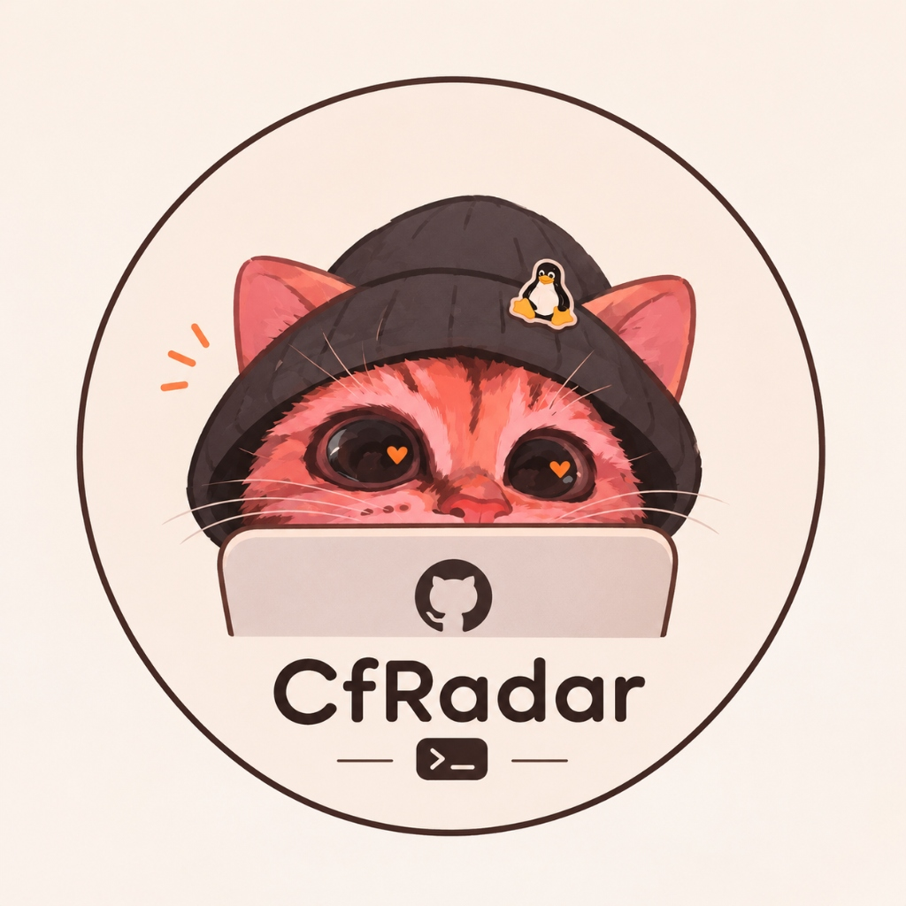

<p align="center">
  
</p>

# Linux & Shell Scripting Practical Course

By **CfRadar** — A 31-topic hands-on Linux and Bash scripting course with 248 guided labs, 31 topic tests, and a comprehensive Final Exam.

## Quick Start

1. **Read the setup guide**: Open [Student_Setup_Guide.pdf](Student_Setup_Guide.pdf) for full instructions on Git Bash, WSL2 (Ubuntu), and workflow tips.
2. **Initialize your student profile** (from the repository root):
   ```bash
   bash setup.sh
   ```
   *(On Windows without WSL2, you can double-click `setup.bat` or run it in Git Bash.)*
3. **Check your course map**:
   ```bash
   bash status.sh
   ```
4. **Unlock and start Topic 01**:
   ```bash
   cd topic-01-terminal-and-shell-fundamentals/01-module
   bash unlock.sh
   ```
   Starter unlock code for `T01-M01`: **`XV7R-RFV7-ZUZE`**

## How Progression Works

- Each topic has `00-sandbox/` (open practice), `01-module/`..`08-module/` (graded labs), and `09-test/` (timed mastery test, 90% required).
- Passing `bash verify.sh` on a unit reveals the unlock code for the next unit.
- To reset a broken workspace at any time, run `bash recover.sh` inside the unit directory.
- Units marked `ENV=any` work in both Git Bash and Linux/WSL2; units marked `ENV=linux` require WSL2 (Ubuntu) or a Linux environment.

## Academic Integrity & License

- Work exclusively inside each unit's `workspace/` directory; do **not** modify `.engine/`, `verify.sh`, `unlock.sh`, or `recover.sh`.
- When you pass `final-exam/`, run `bash export-progress.sh` at the repo root to export your completion summary.
- **License**: See [LICENSE](LICENSE) (MIT License with Author Restrictions — **do not copy**, advertising/linking to the official repo is permitted, and **do not share or modify without permission** from **CfRadar**).
